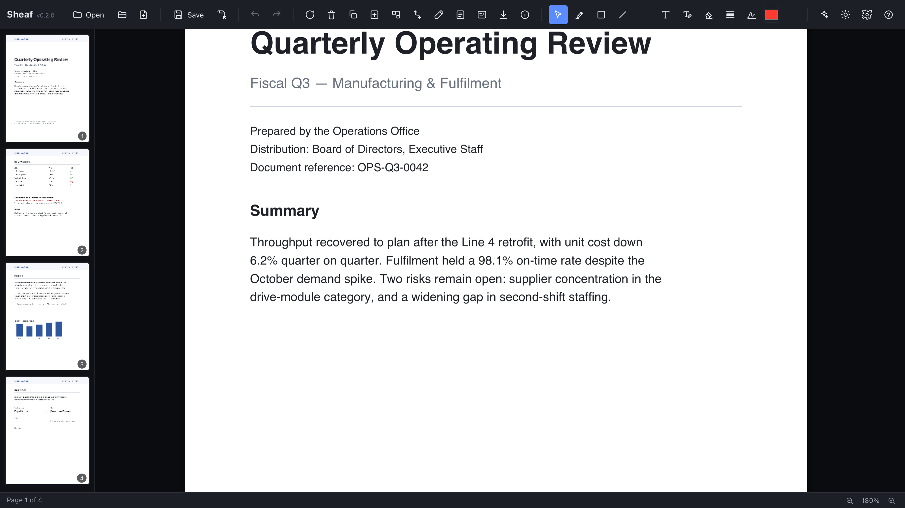

<h1 align="center">Sheaf</h1>

<p align="center">
  <strong>A PDF editor in one HTML file: merge, split, sign, redact, fill, OCR, annotate,<br>
  compress and convert, with the PDF staying on your disk.</strong>
</p>

<p align="center">
  Any modern browser. No account, no upload, no telemetry, no limits.
</p>

<p align="center">
  <a href="LICENSE"></a>
  
  
</p>



## Install

| | |
|---|---|
| **Browser** | Open **[sheaf.naklitechie.com](https://sheaf.naklitechie.com)**. Nothing to install. |
| **NakliOS** | Open Sheaf from the desktop at **[naklios.dev](https://naklios.dev)**. |
| **Your own host** | Serve `index.html`, `commands.json` and `engines/` from any static host, for example `python3 -m http.server`. |

Open a PDF with the toolbar, `Cmd/Ctrl+O`, or a drag onto the page. Every edit stays in the browser's memory
until you save, and `Cmd/Ctrl+Z` steps back through all of them. No config file, no account. Chromium browsers
save in place; Firefox and Safari open and download.

## Why

You have a contract to sign, a scan to shrink and a page to redact, and the free sites want the file on their
server first. Sheaf does that work on your machine. The engines ship with the page, and with no AI configured it
makes no outbound calls.

Redaction removes text from the content stream, and it warns you when it cannot guarantee removal under a box. The
AI sidecar is optional: every operation works without it. A local Ollama or LM Studio is detected automatically,
and a key of your own goes only to the provider you chose.

## Drive it from a script or an assistant

Every operation registers once in `src/core/registry.js` and runs through one runner, whichever door it came from.
The operation log replays without Sheaf's UI and without any model.

- **Developer door:** turn on **Agent face** in Settings to get `window.sheaf` and `?op=<id>&p.<name>=<value>` URL
  mode. Both are off by default, so a link cannot run an operation on your file.
- **NakliOS door:** inside NakliOS, the desktop's voice assistant and Anvil call the commands in `commands.json`.
  The desktop checks each caller's grant and asks you before a change. This door does not need the developer
  setting, and no command saves a file, reads page text or opens a new document.

## Commands

```sh
npm test                 # every headless suite
npm run build            # bundle src/ into index.html and _headers
node scripts/vendor-naklios-sdk.mjs --file src/index.html   # refresh the inlined NakliOS SDK
```

The NakliOS commands: `sheaf.operations.list`, `sheaf.document.read`, `sheaf.operation.run`, `sheaf.operation.undo`.

## Verify it yourself

```sh
npm test
npm run build && git diff --exit-code -- index.html _headers
```

The suites run the real runner and pdf-lib in Node. `test/m0-replay.mjs` is the core gate: it replays the whole
operation log from the opened bytes and refuses a result whose fingerprint differs from the live document. The
second line refuses a committed `index.html` that the sources do not reproduce. Operations that need a browser
canvas (`convert.pageImage`, `ocr.*`, `compress.rasterize`) are outside these suites.

## License

[GNU AGPL-3.0](LICENSE). Derivatives and hosted forks stay open.

[Feature guide](guide/index.html) · Part of [NakliTechie](https://naklitechie.com)
